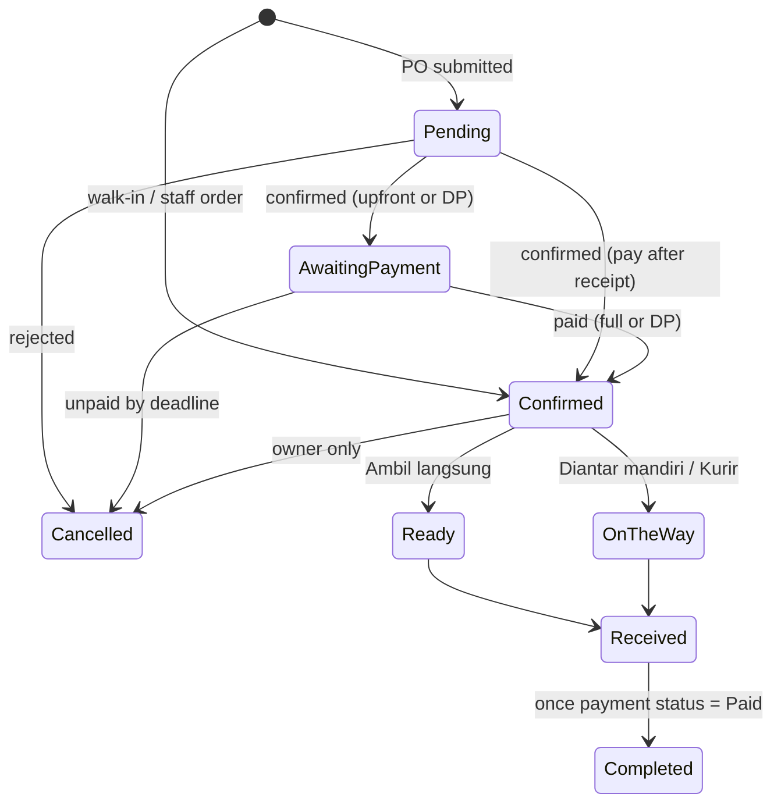

# Bluma Juice POS — Product Requirements Document

Oct 14, 2026 · @Fikriza Ilham

## Overview

Bluma Juice POS is a web app that lets the Bluma Juice team take regular sales orders and scheduled pre-orders (PO), deliver them three ways, and collect payment upfront, by down payment (DP), or after the customer has received the juice. It is built with Claude Code, deployed on Vercel, and runs on free tiers wherever possible.

**Goals**

- Replace WhatsApp-and-notebook order taking with one system for walk-in sales and PO.
- Let customers self-order a PO for a specific open date (e.g. Friday or Saturday) through a public order page.
- Bill each order by its payment term: upfront, DP, or after receipt (default).
- Give the owner a daily view of what to prepare, what to deliver, and what is still unpaid.

**Success metrics (first 3 months)**

| Metric | Target |
| --- | --- |
| Orders recorded in the app vs. outside it | 100% |
| PO orders placed via the public page (not typed by staff) | 70% or more |
| Delivered orders still unpaid after 24 hours | under 5% |
| Time to record a walk-in sale | under 30 seconds |
| Monthly running cost (MVP) | Rp0, excluding QRIS fees |

## Users and roles

Three staff roles log in; customers order without an account, identified by WhatsApp number.

| Role | Who | Can do |
| --- | --- | --- |
| Owner (admin) | Bluma Juice owner | Everything: products, prices, PO schedules, users, reports, cancel/refund |
| Cashier | Counter or order-taking staff | Create sales orders and PO on behalf of customers, mark received, confirm payment, issue invoice |
| Courier (kurir internal) | Bluma staff delivering *diantar mandiri* orders | See assigned deliveries, mark picked up / delivered, upload delivery photo |
| Customer | Public, no login | Browse PO menu, pick a PO date, choose delivery method, track order, open invoice and pay via QRIS |

## Scope

The MVP covers ordering, PO scheduling, delivery tracking, flexible payment terms, invoicing, returns and cash closing for a single outlet.

**In scope (MVP)**

- Product catalog (juice variants, sizes, prices, active/inactive) with batch-based stock for ready-stock items (produced date, expiry, quantity left)
- Regular sales order (walk-in and order taken by staff)
- PO schedules with selectable delivery dates, quota and cut-off
- Public PO order page and order tracking page
- Delivery methods: Ambil langsung (pickup), Diantar mandiri (own staff), Kurir (third-party courier)
- Flexible payment terms (upfront, DP, after receipt) with invoices payable by QRIS, transfer or cash
- Payment confirmation (manual in phase 1, automatic webhook in phase 2)
- Invoice PDF / shareable invoice link, sent via WhatsApp click-to-chat
- Dashboard: today's preparation list, deliveries, unpaid invoices, daily sales

**Out of scope (later)**

- Production planning (make to order / make to stock), stock beyond ready-stock batches, raw materials and recipes (BOM): these run outside the app, which only tags products and lists what to prepare
- Multi-outlet, loyalty points, vouchers
- Automatic courier booking via GoSend/Grab API
- WhatsApp Business API automation (paid)
- Accounting integration

## Core business flows

Every order carries a payment term (section F) that decides when it is billed. Fulfilment is the same for all terms and always ends at **Received**.

### A. Regular sales order (walk-in / direct order)

1. Cashier opens the POS screen, taps products, sets quantity and notes (less sugar, no ice).
2. Cashier selects or creates the customer (name + WhatsApp number; optional for anonymous walk-in).
3. Cashier selects delivery method (Ambil langsung, Diantar mandiri or Kurir) and payment term (default: pay after receipt).
4. Order is saved as Awaiting payment (upfront or DP, until paid) or **Confirmed** and appears on the preparation list (ready stock: pick and hand over; made to order: made first).
5. When the juice is ready: pickup orders go to **Ready for pickup**; delivery orders go to **Out for delivery**.
6. Handover happens; staff (or courier) marks **Received**. For a walk-in customer at the counter, steps 4 to 6 can happen in one tap ("Serahkan sekarang").
7. Any amount still due is billed (section F); once fully paid the order becomes **Paid** and then **Completed**.

### B. Pre-order (PO)

1. Owner creates a **PO schedule**: name (e.g. "PO Minggu ke-3 Oktober"), order window (open/close datetime), selectable delivery dates (e.g. Friday 17 Oct and Saturday 18 Oct), quota per date in bottles (optionally per product), optional delivery time slots (pagi/sore), products (same prices as regular sales), and the payment term for this PO (after receipt, upfront, or DP as a % or amount).
2. Owner shares the public PO link via WhatsApp/Instagram.
3. Customer opens the link, picks a delivery date from the open dates, adds products, chooses delivery method and fills address if delivered.
4. Customer submits; order is **Pending confirmation** and the customer gets a tracking link.
5. Cashier/owner reviews and confirms (or rejects with reason). Quota is taken on confirmation. Upfront and DP orders then wait in Awaiting payment and are auto-cancelled, releasing quota, if unpaid by the deadline (default: the PO cut-off).
6. At cut-off, the schedule closes; the owner sees a preparation recap per delivery date (product × quantity, split into ready stock and made to order).
7. On the delivery date the order follows the same fulfilment path as flow A, steps 5 to 7.

**PO rules**

- A date disappears from the picker when its quota is full or its cut-off has passed.
- Cut-off is per delivery date (default: H-1 at 20:00), configurable.
- Customer can cancel only while status is Pending confirmation; after that, cancel via admin.

### C. Delivery methods

| Method | Who moves the juice | Fee | Received is marked by |
| --- | --- | --- | --- |
| Ambil langsung | Customer picks up at the outlet | None | Cashier, at handover |
| Diantar mandiri | Bluma staff courier | Entered manually by staff per order, added to the invoice | Staff courier, in the courier view (photo optional) |
| Kurir (GoSend, GrabExpress, etc.) | Third-party courier, booked manually by staff | Paid by customer; actual fee entered manually by staff and added to the invoice | Staff, after the customer confirms, or the customer via a "Sudah diterima" button on the tracking page |

### D. Collecting payment

1. Order is marked **Received**; system bills whatever is still due: the full amount, the DP balance, or a courier fee (section F). Upfront and DP invoices go out the same way at confirmation.
2. Customer receives the invoice link on WhatsApp (staff taps a click-to-chat button with a prefilled message).
3. Invoice page shows the amount, items and payment options: QRIS, bank transfer, or cash at handover.
4. Phase 1 (free): static GoPay Merchant QRIS image; customer pays by QRIS or bank transfer and uploads a payment screenshot (cash is recorded by the staff who receives it); cashier verifies and taps **Confirm payment**.
5. Phase 2: dynamic QRIS from a payment gateway with the exact amount; a webhook marks the invoice **Paid** automatically.
6. Unpaid invoices older than 24 hours appear on the dashboard with a one-tap WhatsApp reminder.

### E. Invoice release

- Invoices are created at the billing points of the order's payment term (section F); an order has one full invoice, or a DP invoice plus a balance invoice.
- Number format: `INV/BLM/YYYY/MM/0001`, sequential per month.
- Content: outlet details, customer, order number, delivery date and method, items, delivery or courier fee, total, payment options, payment status; no tax line.
- Customer opens it via a tokenized public link (no login) and can download a PDF.
- Once paid, the invoice shows a **LUNAS** stamp and becomes the receipt.

### F. Payment terms

Each order has one payment term, defaulted from the PO schedule (PO) or from settings (regular sales); staff can change it until the first payment is recorded.

| Term | Billed when | Preparation starts | Billed at Received |
| --- | --- | --- | --- |
| Pay after receipt (default) | Full invoice at Received | Right after confirmation | Full amount |
| Upfront (bayar di muka) | Full invoice at confirmation | After full payment | Only a courier fee unknown at confirmation, if any |
| Down payment (DP) | DP invoice at confirmation; owner sets % (e.g. 50%) or a fixed amount | After DP is paid | Balance = total minus DP, plus courier fee |

**Rules**

- Awaiting payment has a deadline (default: PO cut-off for PO, 2 hours for regular orders); unpaid orders are auto-cancelled and their quota released.
- Walk-in upfront sales are paid at the counter, so the order goes straight to Confirmed as paid.
- A Kurir fee not known at billing time goes on a balance invoice at Received.
- Payment status is tracked separately from fulfilment: Unpaid, DP paid, Paid. An order is Completed only when it is Received and Paid.
- Cancelling after any payment requires the owner to record a refund note (amount, method); whether a DP is refundable is the owner's call per case.

**Customer credit control**

- Each customer has a default payment term (new customers: upfront or DP; trusted customers: after receipt) and an optional outstanding limit.
- If a new order would push the customer's unpaid balance over the limit, or the customer has an invoice overdue by more than 3 days, pay-after-receipt is blocked: the order needs upfront or DP, or an owner override (logged).
- Blocked customers cannot submit the public PO form; they see a message to contact the store.

### G. Ready-stock batches

Every ready-stock delivery from production is recorded as a batch, so staff can see how long each batch has left and where it went.

1. **Batch in:** staff record product, batch code, produced at, quantity; expiry fills from the product's shelf life (editable).
2. **Active:** the batch is sellable; POS takes stock first-expired-first-out (FEFO) and records which batch each sold item came from. Bottles carry a batch sticker, and the cashier can override the batch when the bottle in hand is from a different one.
3. **Expiring soon:** within 24 hours of expiry the batch is flagged on the dashboard so staff can push it first.
4. **Sold out or expired:** at 0 quantity the batch closes; at expiry it stops being sellable automatically.
5. **Written off:** staff record leftover expired quantity as waste, with a reason.

Each batch page shows quantity in, sold, returned, wasted, remaining and time left to expiry, plus the orders it went to.

### H. Returns and complaints

Issued invoices are never edited; corrections go through a void or a credit note so totals always reconcile.

1. Staff records a complaint on the order: reason (spoiled, wrong item, missing, late), items and quantity, optional photo.
2. Owner picks a resolution: **replace** (a free Rp0 replacement order linked to the original), **refund** (credit note plus a refund recorded by method), or **deduct** (credit note reduces an unpaid invoice).
3. Credit notes are numbered `CN/BLM/YYYY/MM/0001` and linked to the invoice; outstanding = invoice amount − payments − credit notes.
4. Returned ready-stock bottles are written off as waste, never put back on sale.
5. A wrong invoice that is not yet paid is voided with a reason and reissued under a new number; void numbers stay in the sequence.

### I. Cash closing (tutup kasir)

1. The cashier opens a shift with the starting cash (modal kas).
2. Every cash payment and cash refund in that shift is linked to it.
3. At close, the system shows expected cash (opening + cash in − cash refunds); the cashier enters counted cash, and any variance is saved with a note.
4. QRIS and transfer payments for the shift are listed for checking against the GoPay Merchant app and bank mutation.

## Order status lifecycle



Payment status (separate field): `unpaid` → `dp_paid` → `paid` (or `unpaid` → `paid` directly). Returns after completion go through a credit note.

Fulfilment status and payment status are tracked separately. Awaiting payment applies only to upfront and DP orders, and only the owner may cancel after confirmation.

## Functional requirements

Priority: P0 = MVP must-have, P1 = MVP if time allows, P2 = later.

| ID | Module | Requirement | Priority |
| --- | --- | --- | --- |
| FR-01 | Auth | Staff log in with email + password; role-based access (owner, cashier, courier) | P0 |
| FR-02 | Catalog | CRUD products with name, size, price (price list with valid-from dates; history kept), photo, active flag, optional PO-only flag, fulfilment type tag (ready stock / made to order) used for the preparation list; staff record ready-stock batches (batch code, produced at, expires at, qty) as goods arrive from production; expiry defaults from the product's shelf life | P0 |
| FR-03 | Customers | Save customer by WhatsApp number (unique), name, default address; auto-create from PO form; tags (reseller, regular), WA opt-in, default payment term, credit limit, blocked flag; export opt-in list for PO broadcasts | P0 |
| FR-04 | POS | Tablet/phone-friendly cart screen: product grid, qty, item notes, discount (owner only), automatic promos (bundle price, buy X get Y) within their validity dates; ready-stock tiles show the sellable quantity (sum of unexpired batches), turn "Habis" at 0, and block selling beyond it (owner can override); batches are taken FEFO automatically | P0 |
| FR-05 | POS | Choose delivery method and payment term; address and delivery fee required for Diantar mandiri / Kurir | P0 |
| FR-06 | PO schedule | Owner creates schedule with order window, delivery dates, optional time slots, quota per date in bottles (optionally per product), cut-off per date, product list (regular prices apply), payment term with DP % or amount, payment deadline | P0 |
| FR-07 | PO public page | Mobile page at `/po/[slug]`: pick date (and time slot if offered), add items, delivery method, name/WA/address, submit; validates quota and cut-off server-side | P0 |
| FR-08 | PO admin | Confirm/reject PO orders; recap per delivery date (product × qty, per delivery method, split by ready stock vs made to order) | P0 |
| FR-09 | Fulfilment | Status transitions per the lifecycle; every change logged with user and timestamp | P0 |
| FR-10 | Courier | Courier view: assigned orders for today, address with Google Maps link, mark delivered, optional photo | P1 |
| FR-11 | Tracking | Public tracking page `/t/[token]` showing status timeline; "Sudah diterima" button for Kurir orders | P0 |
| FR-12 | Invoice | Create invoices at the payment term's billing points (upfront: at confirmation; DP: DP at confirmation + balance at Received; after receipt: at Received); sequential number; public link `/inv/[token]`; PDF download | P0 |
| FR-13 | Payment | Phase 1: GoPay Merchant static QRIS, bank transfer or cash; proof upload for QRIS/transfer; manual confirm; record method, amount, paid\_at, verified\_by | P0 |
| FR-14 | Payment | Phase 2: dynamic QRIS via payment gateway, webhook updates status, signature verified | P2 |
| FR-15 | Notify | WhatsApp click-to-chat (`wa.me`) buttons with prefilled messages: order confirmed, on the way, invoice, reminder | P0 |
| FR-16 | Dashboard | Today: ready-stock left, batches expiring within 24 h, expired batches to write off, preparation list, deliveries by method, unpaid invoices, sales total; filter by date | P0 |
| FR-17 | Reports | Full report set per the Dashboard and reports section; export CSV | P0 |
| FR-18 | Cancel | Owner cancels order with reason; quota restored; paid orders need refund note. Returns, credit notes, voids and cash closing per sections H and I | P1 |
| FR-19 | Print | 58 mm thermal receipt layout via browser print | P2 |

## Dashboard and reports

The dashboard shows today at a glance; reports answer questions over any date range, and every report exports to CSV. Both are P0.

### Dashboard

Home screen for owner and cashier, defaults to today with a date picker. Cashiers see the operational cards only; money cards are owner-only.

| Card | Shows | Who sees it |
| --- | --- | --- |
| Sales today | Net sales, order count, average order value, vs same weekday last week; line of sales by hour | Owner |
| Collected vs outstanding | Paid today by method (QRIS, transfer, cash); unpaid invoices and open DP balances, with WA reminder button | Owner |
| Ready stock | Sellable quantity per product; batches expiring within 24 h; expired batches to write off | Owner, cashier |
| Preparation | Today's orders to prepare, split ready stock vs made to order; PO recap for the next delivery date | Owner, cashier |
| Deliveries | Orders by method and status (Ready, On the way, Received) | Owner, cashier, courier (own only) |
| Open PO | Open schedules, quota used and left per delivery date | Owner, cashier |
| Top products | Top 5 products this week by quantity | Owner |

### Reports

| Report | Answers | Filters | Measures |
| --- | --- | --- | --- |
| Sales summary | How much did we sell? | Date range, order type (regular/PO), delivery method | Gross, discount, delivery fees, net, orders, average order value; by day, week, month |
| Sales by product | What sells best? | Date range, product, fulfilment type | Quantity, revenue, share of revenue, rank |
| Receivables and aging | Who still owes us? | Date range, invoice kind, status | Issued, paid, credit notes, outstanding; aging 0–1, 2–3, 4–7, over 7 days; open DP balances |
| Payment method mix | How do customers pay? | Date range | Amount and count per method; estimated QRIS fee |
| Stock per batch | What is left and how fresh is it? | Product, batch status, expiry window | Batch code, produced, expires, in, sold, returned, wasted, remaining, hours to expiry |
| Stock movements | Where did each batch go? | Batch, product, movement type, date | Movement log with linked orders |
| Waste | How much do we throw away? | Date range, product | Quantity and value written off, waste as % of quantity in, by product and reason |
| PO performance | How did each PO run go? | PO schedule | Orders, quota fill % per date, revenue, cancellations, unpaid after delivery |
| Customers | Who are our best customers? | Date range | Orders, revenue, last order date, outstanding balance |
| Cash received per cashier | Does each person's cash add up? | Date, cashier | Cash and transfer confirmed per user; expected vs counted cash per shift and variance |

**Report rules**

- Sales count non-cancelled orders by handover date (Received, WIB 00:00–23:59), net of credit notes; order date is available as an alternative view; collections count payments by paid date. Both views are shown so sales and cash are never mixed up.
- Waste value uses the selling price, since the POS holds no production cost.
- Reports are Postgres views/functions queried on demand (no extra service); charts use Recharts; CSV generated server-side.
- Dashboard refreshes on load and every 60 seconds while open.

## Data model

Nineteen Postgres tables cover the MVP; money is stored as integer rupiah, times as `timestamptz` in Asia/Jakarta display.

| Table | Key columns | Notes |
| --- | --- | --- |
| `profiles` | id (= auth user id), name, role | role: owner, cashier, courier |
| `products` | id, name, size, price, image\_url, is\_active, is\_po\_only, fulfilment\_type (ready\_stock/made\_to\_order), shelf\_life\_hours |  |
| `customers` | id, name, whatsapp (unique), default\_address, tags, wa\_opt\_in, default\_payment\_term, credit\_limit, is\_blocked |  |
| `po_schedules` | id, slug, name, opens\_at, closes\_at, status, payment\_term, dp\_percent, dp\_amount | status: draft, open, closed |
| `po_dates` | id, schedule\_id, delivery\_date, quota (bottles), cutoff\_at, booked\_count (bottles), time\_slots | one row per selectable date; optional per-product limits in po\_date\_products |
| `po_schedule_products` | schedule\_id, product\_id | products offered in this PO; regular price applies |
| `orders` | id, order\_no, type (regular/po), customer\_id, po\_date\_id, delivery\_method, delivery\_address, delivery\_fee, courier\_name, status, payment\_term, dp\_amount, payment\_status, payment\_due\_at, subtotal, total, public\_token, created\_by | order\_no e.g. `SO-251017-001` / `PO-251017-001` |
| `order_items` | id, order\_id, product\_id, qty, unit\_price, note | price copied at order time |
| `order_status_logs` | id, order\_id, from\_status, to\_status, by\_user, note, created\_at | audit trail |
| `invoices` | id, invoice\_no, order\_id, kind (full/dp/balance), amount, status (unpaid/paid/void), public\_token, issued\_at, paid\_at | one full invoice, or one dp + one balance, per order |
| `payments` | id, invoice\_id, method (qris\_static/qris\_dynamic/bank\_transfer/cash), amount, proof\_url, gateway\_ref, verified\_by, paid\_at |  |

**Ready-stock batch tables**

| Table | Key columns | Notes |
| --- | --- | --- |
| `stock_batches` | id, product\_id, batch\_code, produced\_at, expires\_at, qty\_in, qty\_remaining, status | status: active, sold\_out, expired, written\_off; code e.g. `BLM-ORG-251017-A` |
| `order_item_batches` | order\_item\_id, batch\_id, qty | one sold line can span two batches; gives traceability |
| `stock_movements` | id, batch\_id, type (in/sale/return/write\_off/adjust), qty, order\_id, reason, by\_user, created\_at | the lifecycle log of each batch |

**Pricing, returns and cash tables**

| Table | Key columns | Notes |
| --- | --- | --- |
| `product_prices` | product\_id, price, valid\_from, valid\_to | current price = row valid today; history kept |
| `promotions` | id, name, type (bundle/buy\_x\_get\_y), rules (json), valid\_from, valid\_to, is\_active | applied automatically in POS and PO page |
| `po_date_products` | po\_date\_id, product\_id, quota, booked | optional per-product PO limit |
| `credit_notes` | id, cn\_no, invoice\_id, amount, reason, resolution (replace/refund/deduct), approved\_by | never edits the invoice |
| `cash_sessions` | id, cashier\_id, opened\_at, opening\_cash, closed\_at, expected\_cash, counted\_cash, variance, note | payments.cash\_session\_id links cash to the shift |

**Integrity rules**

- Batch deductions run in one Postgres function, FEFO, with row locks: regular orders deduct at confirmation, PO orders when marked Ready or On the way; a cancel returns quantity to the same batches. Expired batches are never sellable, and a daily cron marks them expired. Quota check and `booked_count` increment run inside one Postgres function (`rpc`) with a row lock, so two customers cannot take the last slot.
- Invoice number from a per-month counter table updated in the same transaction that issues the invoice. Payment deadlines are enforced on every read of the order plus a daily Vercel Cron sweep (Hobby crons run at most daily).
- Row Level Security on: public pages read only through server routes using the order or invoice token, never the anon key directly.

## Tech stack and free-tier architecture

One Next.js app on Vercel talks to one Supabase project; the MVP runs at Rp0 per month, with one licensing caveat on Vercel below.

| Layer | Choice | Free-tier limit that matters |
| --- | --- | --- |
| Framework | Next.js (App Router) + TypeScript, Server Actions + Route Handlers | n/a |
| UI | Tailwind CSS + shadcn/ui, mobile-first; PWA manifest so staff can "install" it on a tablet | n/a |
| Hosting | Vercel Hobby | 100 GB transfer, \~1M function invocations, \~4 h active CPU per month; hard stop at limit ([source](https://zplatform.ai/guides/is-vercel-free/)) |
| Database + Auth + Storage | Supabase Free (Postgres, Auth, Storage for payment proofs and delivery photos) | 500 MB DB, 1 GB files, 5 GB egress, 2 projects; pauses after 7 days idle ([source](https://automationatlas.io/answers/supabase-free-tier-limits-2026/)) |
| DB access | Supabase JS client + SQL migrations in `supabase/migrations` (or Drizzle ORM) | n/a |
| Validation | Zod on every form and route | n/a |
| PDF | `@react-pdf/renderer` in a route handler | keep under function time limit |
| QR rendering | `qrcode` package for dynamic QRIS strings | n/a |
| Notifications | WhatsApp click-to-chat links (`https://wa.me/62…?text=…`) | free, manual tap |
| Payments phase 1 | GoPay Merchant static QRIS, bank transfer and cash, all confirmed manually | no gateway fee |
| Payments phase 2 | Dynamic QRIS via Midtrans (or Xendit) Core API + webhook | MDR 0.7% per regular transaction ([source](https://docs.midtrans.com/docs/what-is-the-applicable-transaction-fee-for-qris-1)) |
| Images | Product photos compressed to WebP under 200 KB in Supabase Storage | stays well inside 1 GB |
| Keep-alive | Vercel Cron (daily) hits a tiny DB query | prevents the 7-day Supabase pause |

**Important caveats on "free"**

- **Vercel Hobby is non-commercial.** Vercel's terms restrict Hobby to personal, non-commercial use; a revenue-generating app needs Pro at $20 per user per month ([source](https://zplatform.ai/guides/is-vercel-free/)). Decision (14 Oct 2026): pilot on Hobby now and upgrade to Pro once real daily sales run through the app. Avoid Vercel-only features beyond Cron so the app could also move to a commercial-friendly host (e.g. Cloudflare Workers via OpenNext).
- **QRIS always has an MDR fee unless micro-merchant rules apply.** Banks list 0% MDR for micro businesses (UMI) on transactions up to Rp500.000 and 0.3% above that ([source](https://www.banksampoerna.com/article/API-Merchant-QRIS)). Register the Bluma QRIS as UMI if eligible.
- Supabase Free has no daily backups; schedule a weekly `pg_dump` (GitHub Actions free minutes) to a private repo or Google Drive.

**Environment variables**

- `NEXT_PUBLIC_SUPABASE_URL`, `NEXT_PUBLIC_SUPABASE_ANON_KEY`, `SUPABASE_SERVICE_ROLE_KEY` (server only)
- `APP_BASE_URL`, `CRON_SECRET`
- Phase 2: `MIDTRANS_SERVER_KEY`, `MIDTRANS_IS_PRODUCTION`

## Non-functional requirements

| Area | Requirement |
| --- | --- |
| Device | Mobile-first; POS usable on a 10" tablet and a 6" phone; public pages load under 2 s on 4G |
| Language | UI in Bahasa Indonesia; code, DB and commits in English |
| Locale | Rupiah format `Rp25.000`, dates `Jumat, 17 Okt 2026`, timezone Asia/Jakarta (WIB) everywhere |
| Security | Supabase RLS on all tables; service-role key only on server; public links use 32-char random tokens; rate-limit public PO submit (e.g. 5 per minute per IP) and add Cloudflare Turnstile (free) to the PO form |
| Data integrity | Status changes only through server functions that enforce allowed transitions; prices copied into order lines; payment confirmation and webhooks are idempotent (one confirm per payment, unique gateway reference) |
| Privacy | Customer phone/address visible only to logged-in staff; tracking and invoice pages show first name and masked phone |
| Availability | Best effort on free tiers; daily keep-alive cron; weekly DB backup |
| Audit | Every status change and payment confirmation logged with user and time |

## Build plan with Claude Code

Ship in two releases: Release 1 runs daily selling and PO; Release 2 adds batches, full reports and credit control. One Claude Code session per phase; commit and deploy a Vercel preview after each.

| Release | Phase | Deliverable | Done when |
| --- | --- | --- | --- |
| R1 | 0. Setup | Next.js + Tailwind + shadcn/ui, Supabase project, GitHub repo linked to Vercel Hobby, `CLAUDE.md` | Preview URL shows login page |
| R1 | 1. Data + auth | Migrations, RLS, seed products and prices, staff login with roles | Owner and cashier can log in |
| R1 | 2. Regular sales | POS cart, price list, promos, customers, delivery method, status transitions + logs | A walk-in order goes Confirmed to Received |
| R1 | 3. PO | PO schedule with bottle quota and time slots, public `/po/[slug]` with Turnstile, confirm/reject, preparation recap | Two browsers cannot book past quota |
| R1 | 4. Pay + invoice | Payment terms, invoices, QRIS/transfer/cash, voids and credit notes, cash closing, WA buttons, tracking page | A PO with DP ends Paid with LUNAS invoice; shift closes with zero variance |
| R1 | 5. Basic dashboard | Sales, collections, outstanding, preparation and delivery cards; keep-alive cron; weekly backup | Owner runs a real Friday PO end to end |
| R2 | 6. Batches | Ready-stock batches, FEFO with override, expiry flags, write-off | Batch page reconciles in = sold + wasted + remaining |
| R2 | 7. Reports | Full report set + CSV, stock and waste cards on dashboard | Month-end numbers match collections |
| R2 | 8. Customers + courier | Credit control, tags, opt-in export, courier view | Over-limit customer is forced to upfront |
| Later | 9. Gateway | Midtrans dynamic QRIS + webhook | Payment marks Paid without staff |

**Suggested folder structure**

```
app/
  (staff)/pos, orders, po, invoices, dashboard, settings
  (public)/po/[slug], t/[token], inv/[token]
  api/cron/keepalive, api/invoices/[token]/pdf, api/webhooks/midtrans
lib/ supabase/, orders/ (state machine), money.ts, wa.ts
supabase/migrations/
```

**What to put in `CLAUDE.md`**

- Link or paste this PRD; state the stack and "free tier first".
- Order status enum and the allowed-transition map (single source of truth in `lib/orders/state.ts`).
- Conventions: integer rupiah, WIB timezone, Bahasa Indonesia UI strings, Zod on every input, server-only service key.
- Commands: `pnpm dev`, `pnpm lint`, `pnpm typecheck`, `supabase db push`.

**Working tips**

- Start each phase in plan mode: ask Claude Code to propose the plan, review it, then let it implement.
- One phase per prompt, e.g. "Implement Phase 3 from PRD.md. Quota must be enforced in a Postgres function with row locking. Write the migration first, then the UI."
- Ask it to write tests for the state machine and the quota RPC before the UI.
- Run `pnpm build` locally before pushing so Vercel builds don't fail.

## Risks and open questions

| Risk | Impact | Mitigation |
| --- | --- | --- |
| Customer receives juice but never pays | Revenue loss | Dashboard of unpaid invoices, WA reminder, use upfront or DP terms for new customers and large PO; follow up within 24 hours |
| Static QRIS proof is faked | Revenue loss | Cashier checks the GoPay Merchant app or bank mutation before confirming; phase 2 gateway removes this |
| Vercel Hobby used commercially | Account suspension | Pilot on Hobby (owner's decision), upgrade to Pro once daily sales run through the app |
| Free-tier limits or pause | Downtime | Keep-alive cron, small images, weekly backup |
| PO overbooking | Can't produce enough | Quota enforced in DB transaction |

**Owner decisions (answered 14 Oct 2026)**

| Question | Decision |
| --- | --- |
| Deposit (DP) for PO | Flexible per order or PO schedule: upfront, DP, or after receipt (default) |
| Diantar mandiri fee | Entered manually per order |
| Kurir fee | Paid by customer, entered manually, added to the invoice |
| Payment methods | QRIS, bank transfer, or cash |
| PO prices | Same as regular prices |
| QRIS provider | GoPay Merchant |
| Tax line on invoice | None |

QRIS fee: Bluma is an UMKM. Check in the GoPay Merchant app that it is classed as **usaha mikro (UMI)**: then QRIS costs 0% up to Rp500.000 per transaction and 0.3% above. A business classed as small (usaha kecil) pays the regular 0.7%.

## Sources

- [Vercel Hobby plan: non-commercial use and limits](https://zplatform.ai/guides/is-vercel-free/)
- [Supabase free tier limits 2026](https://automationatlas.io/answers/supabase-free-tier-limits-2026/)
- [Midtrans: QRIS transaction fee](https://docs.midtrans.com/docs/what-is-the-applicable-transaction-fee-for-qris-1)
- [Midtrans: static vs dynamic QRIS](https://docs.midtrans.com/docs/introduction-to-static-qris)
- [Bank Sampoerna: QRIS MDR for micro businesses](https://www.banksampoerna.com/article/API-Merchant-QRIS)
