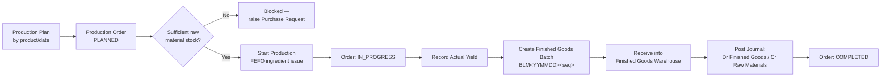
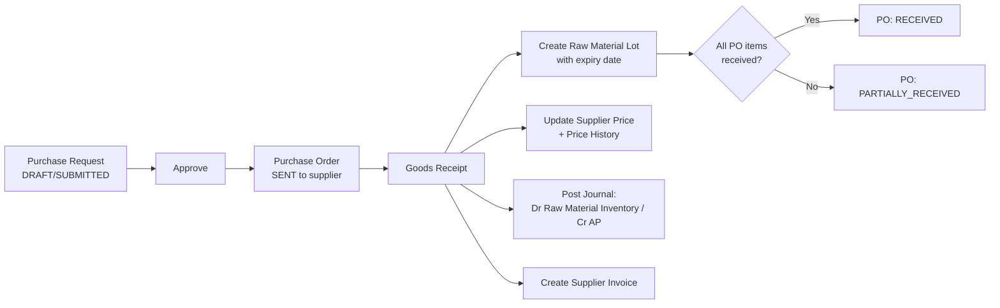
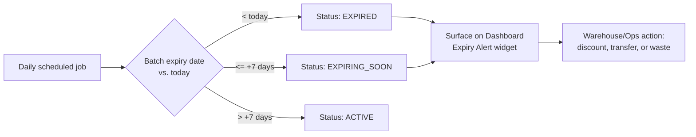
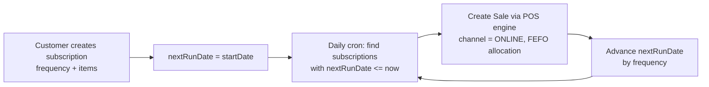
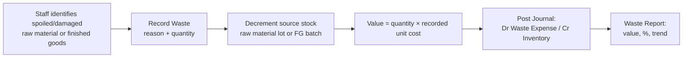
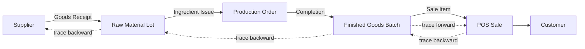

# Business Process Diagrams

## 1. Manufacturing: Plan → Batch



## 2. Purchasing: Request → Lot



## 3. POS Sale with FEFO Allocation

```mermaid
flowchart TD
    A[Cashier scans/searches product] --> B[Add to cart]
    B --> C[Checkout: warehouse + payment method]
    C --> D[For each cart line:\nquery batches for product\nin warehouse, sort by expiry ASC]
    D --> E[Consume soonest-expiring\nbatch(es) first — split line\nacross batches if needed]
    E --> F[Decrement FinishedGoodsStock\n+ write StockMovement]
    F --> G[Compute subtotal, coupon\ndiscount, total]
    G --> H[Create Sale + SaleItems\nlinked to batch]
    H --> I[Post Journal:\nDr Cash/Bank / Cr Revenue]
    H --> J[Post Journal:\nDr COGS / Cr Finished Goods\nat batch unit cost]
    H --> K[Award loyalty points\nif member customer]
    K --> L[Print Receipt:\nbatch #, production date, expiry date]
```

## 4. Expiry Management (FEFO + Alerts)



## 5. Subscription Auto-Order



## 6. Waste Recording



## 7. Traceability (Batch ⇄ Ingredients ⇄ Customer)


