# Entity-Relationship Diagram (ERD)

Full field-level detail lives in `backend/prisma/schema.prisma` (the single source of truth —
this diagram mirrors it). Attributes below are trimmed to the ones that matter for
understanding relationships; see `05-database-schema.md` for the complete table reference.

```mermaid
erDiagram
    USER ||--o{ PRODUCTION_ORDER : operates
    USER ||--o{ SALE : cashiers
    USER ||--o{ WASTE_RECORD : records
    USER ||--o{ DELIVERY : drives
    USER ||--o{ JOURNAL_ENTRY : creates

    PRODUCT ||--o{ RECIPE : "has versions"
    RECIPE ||--o{ RECIPE_INGREDIENT : contains
    RAW_MATERIAL ||--o{ RECIPE_INGREDIENT : "used in"
    RAW_MATERIAL ||--o{ SUPPLIER_RAW_MATERIAL : "supplied by"
    SUPPLIER ||--o{ SUPPLIER_RAW_MATERIAL : supplies
    SUPPLIER ||--o{ PRICE_HISTORY : "price quoted"
    RAW_MATERIAL ||--o{ PRICE_HISTORY : "priced over time"

    SUPPLIER ||--o{ PURCHASE_ORDER : "receives orders"
    PURCHASE_REQUEST ||--o{ PURCHASE_REQUEST_ITEM : lists
    PURCHASE_REQUEST ||--o{ PURCHASE_ORDER : "converted to"
    PURCHASE_ORDER ||--o{ PURCHASE_ORDER_ITEM : lists
    PURCHASE_ORDER ||--o{ GOODS_RECEIPT : "received via"
    GOODS_RECEIPT ||--o{ GOODS_RECEIPT_ITEM : lists
    GOODS_RECEIPT_ITEM ||--|| RAW_MATERIAL_LOT : "creates"
    PURCHASE_ORDER ||--o{ SUPPLIER_INVOICE : bills

    WAREHOUSE ||--o{ RAW_MATERIAL_LOT : stores
    WAREHOUSE ||--o{ FINISHED_GOODS_STOCK : stores
    WAREHOUSE ||--o{ PRODUCTION_ORDER : "produces at"
    WAREHOUSE ||--o{ SALE : "fulfills from"
    WAREHOUSE ||--o{ STOCK_OPNAME : "counted at"

    PRODUCT ||--o{ PRODUCTION_ORDER : plans
    RECIPE ||--o{ PRODUCTION_ORDER : "used by"
    PRODUCTION_ORDER ||--o{ PRODUCTION_ORDER_INGREDIENT_ISSUE : issues
    RAW_MATERIAL_LOT ||--o{ PRODUCTION_ORDER_INGREDIENT_ISSUE : "consumed as"
    PRODUCTION_ORDER ||--|| FINISHED_GOODS_BATCH : "completes into"
    PRODUCT ||--o{ FINISHED_GOODS_BATCH : "produced as"
    FINISHED_GOODS_BATCH ||--o{ FINISHED_GOODS_STOCK : "held in"

    CUSTOMER ||--o{ SALE : purchases
    CUSTOMER ||--o{ SUBSCRIPTION : subscribes
    CUSTOMER ||--o{ DELIVERY : receives
    LOYALTY_TIER ||--o{ CUSTOMER : tiers
    COUPON ||--o{ SALE : discounts

    SALE ||--o{ SALE_ITEM : lists
    PRODUCT ||--o{ SALE_ITEM : sold
    FINISHED_GOODS_BATCH ||--o{ SALE_ITEM : "allocated (FEFO)"
    SALE ||--o{ DELIVERY : fulfilled_by

    SUBSCRIPTION ||--o{ SUBSCRIPTION_ITEM : lists
    PRODUCT ||--o{ SUBSCRIPTION_ITEM : includes

    VEHICLE ||--o{ DELIVERY : assigned

    MARKETPLACE_CHANNEL ||--o{ MARKETPLACE_ORDER : syncs

    RAW_MATERIAL ||--o{ WASTE_RECORD : wasted
    RAW_MATERIAL_LOT ||--o{ WASTE_RECORD : wasted
    FINISHED_GOODS_BATCH ||--o{ WASTE_RECORD : wasted

    ACCOUNT ||--o{ JOURNAL_LINE : posted_to
    JOURNAL_ENTRY ||--o{ JOURNAL_LINE : contains

    STOCK_OPNAME ||--o{ STOCK_OPNAME_LINE : counts

    PRODUCT {
        string sku
        string barcode
        string name
        string size
        decimal sellingPrice
        int shelfLifeDays
        string status
    }
    RECIPE {
        string name
        int version
        decimal standardYieldQty
    }
    RAW_MATERIAL {
        string sku
        string category
        string unit
        int shelfLifeDays
    }
    RAW_MATERIAL_LOT {
        string lotNumber
        decimal quantityReceived
        decimal quantityRemaining
        decimal unitCost
        datetime expiryDate
    }
    FINISHED_GOODS_BATCH {
        string batchNumber
        datetime productionDate
        datetime expiryDate
        decimal quantityProduced
        decimal unitCost
        string status
    }
    SALE {
        string saleNumber
        string channel
        decimal totalAmount
        string paymentMethod
    }
    JOURNAL_ENTRY {
        string entryNumber
        string sourceType
        datetime date
    }
```

## Notes

- **Batch traceability spine**: `Supplier → RawMaterialLot → ProductionOrderIngredientIssue →
  ProductionOrder → FinishedGoodsBatch → SaleItem → Sale → Customer`. Every arrow is a real
  foreign key, so a full trace in either direction is a set of joins, not a reconstruction.
- **Stock is never a single number.** Raw materials are tracked per lot
  (`RawMaterialLot.quantityRemaining`); finished goods per batch-per-warehouse
  (`FinishedGoodsStock`). This is what makes FEFO and expiry alerts possible.
- **`StockMovement`** (not shown above for space) is an append-only ledger of every
  inventory-affecting event (goods receipt, production issue/receipt, transfer, adjustment,
  sale, waste, opname) — the audit trail behind the balances.
- **Accounting** entities (`Account`, `JournalEntry`, `JournalLine`) are deliberately generic:
  every module posts through one `AccountingService.postJournal()` call, so adding a new
  transaction type never requires new accounting tables.
